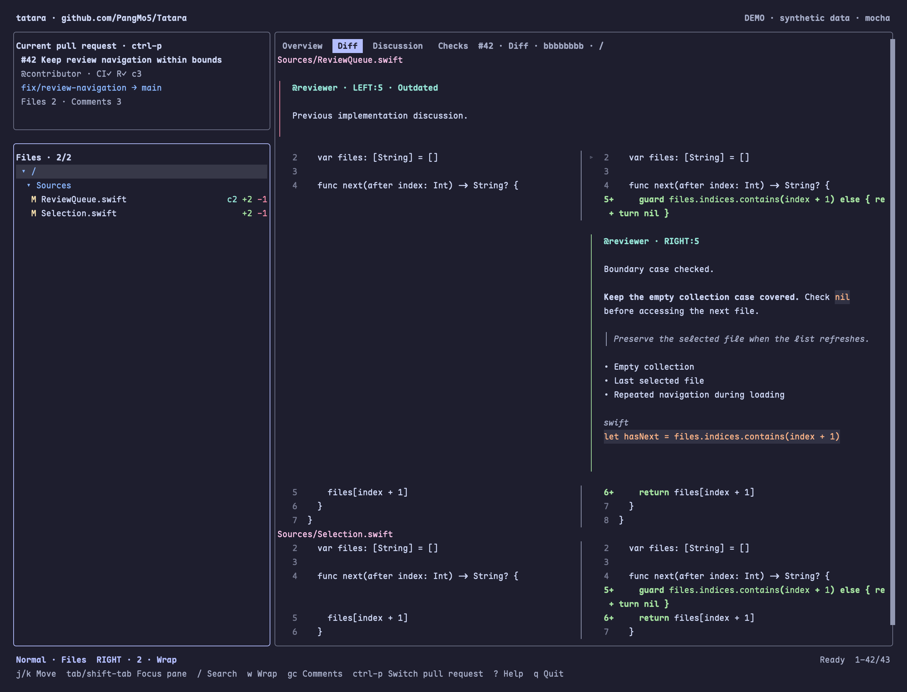

# Tatara

A terminal workspace for reading and reviewing pull requests, with
[difftastic](https://github.com/Wilfred/difftastic) for structural diffs,
Vim motions, and a pane-based review workflow.



Synthetic demo, rendered from an actual PTY capture.

Tatara currently supports **GitHub through `gh`**, including GitHub Enterprise.
It runs on macOS 15 or newer. GitLab and other forges can be added behind the same
client boundary while retaining their own terminology and capabilities.

## Try from source

Requires Xcode with Swift 6.3 or newer and [mise](https://mise.jdx.dev).

```sh
mise install
mise run generate
mise run build
DerivedData/Build/Products/Debug/tatara --demo

gh auth login
DerivedData/Build/Products/Debug/tatara --repo OWNER/REPO
```

Run without `--repo` inside a repository to use `gh repo view`'s repository
selection. `--host github.example.com --repo OWNER/REPO` selects an Enterprise
host; authenticate it first with `gh auth login --hostname github.example.com`.

For a local optimized installation, run `swift Scripts/Tatara.swift build Release`
and `swift Scripts/Tatara.swift install-local`. This installs into
`~/.local/share/tatara/local/bin`; add that directory to your mise environment
PATH. Re-run the installer after rebuilding, then restart Tatara.

## Binary installation

The first public release and Homebrew tap publication have **not happened yet**.
The release workflow prepares the following installation paths.

Recommended, after publication:

```sh
mise use -g github:PangMo5/Tatara
mise use -g aqua:cli/cli aqua:Wilfred/difftastic
gh auth login
tatara --repo OWNER/REPO
```

Homebrew, after publication:

```sh
brew install PangMo5/tap/tatara
```

Use `mise upgrade github:PangMo5/Tatara` or `brew upgrade tatara` for updates.
Release archives include the executable, AGPL license, dependency notices and a
corresponding-source reference. See [release setup](docs/RELEASING.md).

## Review workflow

- `j/k` or arrows move the selection or diff cursor. `Tab` and `Shift-Tab`
  cycle keyboard pane focus. `Enter` opens a PR into Files and a file into Diff.
  The active pane has a Lavender border.
- PR and file lists keep up to two neighboring entries visible above and below
  the selection. The viewport stays in place until the selection crosses either
  margin, including when reversing direction. Short panes use smaller margins.
- `i` toggles compact/rich information. Compact PR rows show state, CI (`CI`),
  review decision (`R`), and comment count (`c`); rich rows add author, update date,
  and labels. `✓`/`+` means passed/approved, `!` means failed/changes requested,
  and `?` means review required. The Overview spells out each status. Missing
  metadata is not treated as a success or zero.
- Rich Overview adds assignees, requested reviewers/teams, milestone, timestamps,
  and revision identity. Both modes show branches and change totals when available.
  Use `--detail-level rich` or configure the default below. GitHub metadata is
  refreshed with the existing `r` action; Projects and derived checklist progress
  are not currently fetched. See [the field mapping](docs/PROVIDER_INFORMATION_2026-09-10.md).
- Files use a directory tree by default. `Enter` folds/unfolds directories;
  `h` collapses or selects the parent, and `l` expands or enters a child.
  Focusing a directory shows the combined diff of its changed descendants.
- `[` / `]` switch Overview, Diff, Discussion and Checks.
- `gg/G` jump to first/last; `Ctrl-d/Ctrl-u` move half a page.
- `/` in PRs submits a GitHub search query on `Enter`, including qualifiers such
  as `is:open label:bug author:@me`. In Files it searches changed-file contents
  with a regular expression, preserving matching files and their parent folders.
  Added/modified files use the reviewed head; deleted files use the merge base.
- `/` in Diff highlights regular-expression matches; `n/N` move to the next or
  previous occurrence and reveal matches beyond the visible columns. Patterns
  are case-sensitive; use `(?i)` for case-insensitive search. `Enter` keeps the
  query active; `Esc` clears it without changing panes. `L` loads another page.
- In Diff, `*` / `#` search the current word forward/backward; `g*` / `g#`
  also match inside longer words. The line cursor uses the first keyword on the
  line, or the word at the current search hit. `n` follows the search direction;
  `N` reverses it. `zt` / `zz` / `zb` place the current line toward the top,
  center, or bottom of the viewport, clamped at document boundaries.
- `Ctrl-f/Ctrl-b` scroll the main pane by half a page while keeping sidebar focus.
- Scrollbars show the visible range in each pane and help. Click or drag a track
  to scroll without changing keyboard focus, item selection or the Diff cursor.
- Use the mouse wheel or trackpad over a pane to scroll it without moving
  keyboard focus or the Diff source cursor. Sidebar scrolling preserves the
  selected item and file; the help popup owns scrolling while open.
- `I` switches PRs and issues. `r` refreshes from a sidebar. `o` opens the original in a browser.
- `Space` marks the selected file reviewed for this PR's exact base/head revision.
- In Diff, `h/l` choose LEFT/RIGHT. `Shift-V` starts linewise selection, `j/k`
  extend it, and `Esc` clears it. `c` or `r` opens the cursor/range comment editor
  inline beneath the source line. Existing comments and pending drafts appear
  in the diff; outdated comments are identified under their file header.
  A range must fit one file and a reviewable GitHub hunk.
  `R` opens the review summary inline in Diff. Preview shows every comment and range before
  Submit; no review is posted just by pressing `c` or `r`.
- `c` from a file list also supports manual source coordinates. Issues support
  ordinary comments.
- `f` opens remote filters, a repository label picker, and saved presets. Use GitHub qualifiers such as
  `is:open author:@me`, `review-requested:@me`, `label:bug`, `draft:false` or
  `is:merged`. Built-in presets cover common queues; named custom presets are
  stored per forge/repository in `$XDG_DATA_HOME/tatara/state/filters.sqlite`
  (default `~/.local/share/tatara/state/filters.sqlite`), independently of caches.
- `T` cycles Catppuccin flavors. `?` opens a searchable key-binding popup;
  `/` filters its commands. `Esc` clears that search, then closes the popup. `q` quits.

Inside review editors, use the native text editing keys and Tab to move between
fields/buttons. Esc returns to the workspace. Drafts and reviewed marks are kept
only for the lifetime of the process. A changed head requires a refreshed review.

## Configuration

Create `$XDG_CONFIG_HOME/tatara/config.toml` (default `~/.config/tatara/config.toml`):

```toml
theme = "mocha" # latte, frappe, macchiato, mocha
language = "ko" # en, ko, ja, zh-Hans, zh-Hant
files_view = "tree" # tree or list
sidebar_width = 52 # preferred PR/Files width in columns; minimum 24
detail_level = "compact" # compact or rich; i toggles for the current session

[keys]
quit = ["Q"]
```

`--theme`, `--language`, `--files-view`, `--sidebar-width`, `--detail-level` and `--config` override the defaults.
PR and Files share the configured width. Narrow windows reduce it to leave at
least 60 columns for content; windows below 100 columns show one pane at a time.
Conflicting bindings
are errors. `--no-color`, `--ascii` and `--accessible` are provided by Tatara.
The complete locale policy is in [LOCALIZATION.md](docs/LOCALIZATION.md).

## Local cache

SQLiteData stores cached reads in `$XDG_CACHE_HOME/tatara/cache.sqlite`
(default `~/.cache/tatara/cache.sqlite`). Entries are scoped to the authenticated
GitHub account, host and repository. Lists and PR details expire after 30 seconds;
`r` in a sidebar bypasses cached metadata. Immutable file snapshots and structured
difftastic results are reused across launches, keyed by repository, revisions,
paths and engine version. Width/theme changes do not rerun the structural diff.
The cache retains at most 128 MiB of payloads and 256 entries. Review submission
always checks the current remote head and merge base. Authentication still requires `gh`.

Within a session, a bounded cache also reuses prepared text and diff viewports.
While another selection loads, a banner identifies the previous preview until
its replacement is ready. Review entry waits for the selected preview to finish.

Interactive diffs use difftastic's JSON alignment and token coordinates, then
validate source anchors against GitHub's patch. Tatara enables `DFT_UNSTABLE=yes`
for its child process; JSON schema mismatches are visible errors. Formats without
source alignment, including binary and syntactically unchanged results, do not
invent cursor anchors. The adapter is validated against difftastic 0.69/0.70.

## Development

Tuist owns the project graph. TCA owns application state and effects. TermLoom
owns terminal layout, input and rendering. Swift Subprocess runs `gh` and `difft`
with explicit arguments and cancellation. TOML configures user preferences.
All project automation is Swift: `Scripts/Tatara.swift` drives development and
releases; `Scripts/Smoke` is a Swift package using SwiftTerm for real PTY checks.
The generation command applies a checksum-verified patch to the pinned TermLoom
input parser so horizontal wheel events retain their axis. Build validation rejects
an unpatched checkout. Remove the patch in `Scripts/Tatara.swift` when the upstream
dependency provides the fix; changed source checksums require an explicit review.

```sh
mise run test
mise run format
swift Scripts/Tatara.swift localizations --check
swift Scripts/Tatara.swift notices --check
uvx --from 'reuse[charset-normalizer]' reuse lint
swift Scripts/Tatara.swift smoke DerivedData/Build/Products/Debug/tatara
swift Scripts/Tatara.swift smoke DerivedData/Build/Products/Release/tatara --workspace
swift Scripts/Tatara.swift smoke DerivedData/Build/Products/Release/tatara --stress
```

See [architecture and initial boundaries](docs/ARCHITECTURE.md),
[performance measurement](docs/PERFORMANCE.md),
[contributing](CONTRIBUTING.md) and [third-party notices](THIRD_PARTY_NOTICES.md).

## License

[AGPL-3.0-only](LICENSE). Included dependencies retain their licenses;
see [third-party notices](THIRD_PARTY_NOTICES.md).
